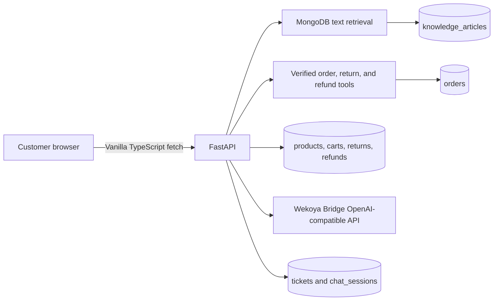

# Support Copilot

Support Copilot is a polished portfolio MVP for a fictional Lagos electronics retailer, **Kora Electronics**. It combines curated MongoDB support articles, verified demo order records, and Wekoya Bridge AI into a compact customer-support experience.

The backend uses the official PyMongo async client for MongoDB connection, CRUD operations, and index management. Memcached tracks lightweight user/session activity while MongoDB remains the durable source of truth.

## Features

- Curated knowledge-base retrieval with MongoDB text search
- Retrieved-article citations with an in-page reference panel
- Verified order-status tool calls scoped to the selected demo customer
- Safe refusal and human escalation when information is insufficient
- Mock human-support ticket creation
- Seeded product catalog, cart, mock checkout, and user-owned orders
- Return and refund status workflows
- Responsive, keyboard-accessible vanilla TypeScript interface
- Limited retries for transient Wekoya/Bridge failures
- Session persistence in MongoDB and localStorage



## Prerequisites

- Python 3.12
- [uv](https://docs.astral.sh/uv/)
- Node.js 20+ and npm
- Docker with Docker Compose

## Wekoya setup

1. Create a Bridge account.
2. Top up the Wekoya wallet.
3. Create a Bridge API key.
4. Copy `.env.example` to `backend/.env` and put the key in `WEKOYA_API_KEY`.
5. Keep `WEKOYA_MODEL=gemini-2.5-flash-lite`.

The API key is used only by the FastAPI server. Never add it to frontend files or expose it through API responses.

## Start locally

Start MongoDB and Memcached:

```bash
docker compose up -d mongodb memcached
```

Create the Python environment and seed the catalog and support data:

```bash
cd backend
uv sync --extra test
cp ../.env.example ../backend/.env
uv run python -m app.seed
```

Start FastAPI:

```bash
cd backend
uv run uvicorn app.main:app --reload --host 0.0.0.0 --port 8000
```

Start Vite in another terminal:

```bash
cd frontend
npm install
npm run dev
```

Open `http://localhost:5173`.

The browser creates a stable anonymous `user_id` in localStorage. Each chat session is ownership-checked against that user ID. Memcached stores only short-lived activity metadata; it is safe to lose or restart.

## Tests

```bash
cd backend
uv run pytest
```

Production frontend build:

```bash
cd frontend
npm run build
```

## Deploy to Render

The repository includes a [`render.yaml`](file:///home/aeemars/Downloads/support%20copilot/render.yaml) Blueprint and [`Procfile`](file:///home/aeemars/Downloads/support%20copilot/Procfile) for zero-config deployment.

### Option 1: Render Blueprint (Recommended)
1. Push your repository to GitHub.
2. In the Render Dashboard, click **New +** -> **Blueprint**.
3. Connect your repository. Render automatically reads `render.yaml` and configures the service.
4. Set your secret environment variables:
   - `MONGODB_URI`: Your MongoDB Atlas connection string (e.g. `mongodb+srv://...`).
   - `WEKOYA_API_KEY`: Your Wekoya Bridge API key.
5. Click **Apply**.

### Option 2: Manual Web Service
- **Environment / Runtime:** Python
- **Build Command:** `cd frontend && npm install && npm run build && cd ../backend && pip install -r requirements.txt`
- **Start Command:** `cd backend && gunicorn -k uvicorn.workers.UvicornWorker -w 2 -b 0.0.0.0:$PORT app.main:app`
- **Environment Variables:**
  - `PYTHON_VERSION`: `3.12.7`
  - `NODE_VERSION`: `20.18.0`
  - `MONGODB_URI`: `mongodb+srv://<user>:<password>@cluster.mongodb.net/?retryWrites=true&w=majority`
  - `MONGODB_DB`: `support_copilot`
  - `WEKOYA_API_KEY`: your Bridge API key
  - `WEKOYA_MODEL`: `gemini-2.5-flash-lite`
  - `CORS_ORIGINS`: `*`

FastAPI automatically serves the compiled SPA frontend from `frontend/dist` on the same origin while serving `/api` endpoints, avoiding cross-origin issues. On first launch against an empty MongoDB Atlas database, the backend automatically seeds the initial catalogue and knowledge articles.

## Example requests

Health:

```bash
curl http://localhost:8000/api/health
```

Chat:

```bash
curl -X POST http://localhost:8000/api/chat \
  -H 'Content-Type: application/json' \
  -d '{"user_id":"browser-user-123","message":"What is your return policy?"}'
```

Order status:

```bash
curl -X POST http://localhost:8000/api/chat \
  -H 'Content-Type: application/json' \
  -d '{"user_id":"browser-user-123","message":"Where is order KORA-1001?"}'
```

Create a ticket:

```bash
curl -X POST http://localhost:8000/api/tickets \
  -H 'Content-Type: application/json' \
  -d '{"user_id":"browser-user-123","subject":"Damaged item","description":"My item arrived damaged."}'
```

## Screenshot

**Screenshot/GIF placeholder:** add a demo screenshot or recording here.

## Limitations and planned upgrades

- Replace MongoDB text search with MongoDB Atlas Vector Search
- Add embeddings for semantic retrieval
- Add streaming responses with SSE
- Add authentication and real customer identity
- Integrate a real ticketing provider
- Add per-user Wekoya budgets
