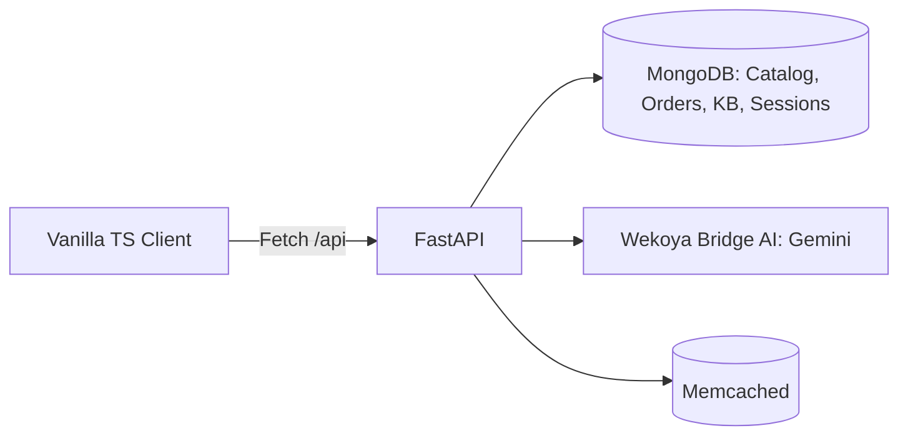

# Support Copilot

Conversational commerce and customer-support assistant for **Kora Electronics**, a fictional Lagos electronics retailer. Built with FastAPI, MongoDB, vanilla TypeScript, and Wekoya Bridge AI (`gemini-2.5-flash-lite`).

## Features

- **Conversational Commerce**: Discover products, configure items, and place orders directly in chat.
- **Order & Post-Purchase Flows**: Check status, cancel processing orders, and request returns or refunds conversationally.
- **Grounded Knowledge & Citations**: MongoDB text search over support policies with interactive reference citations.
- **Human Escalation**: Ticket creation when automated resolution is unavailable or insufficient.
- **Idempotent Mutations**: Guarantees single-mutation consistency for orders, returns, and refunds across retries.
- **Real-time Activity Sync**: Immediate UI updates for placed orders, active returns, and refunds.



## Demo Video
- ***Demo*: /home/aeemars/Downloads/support copilot/Wekoya-Demo.mp4

## Quickstart

### Prerequisites
- Python 3.12+ and [uv](https://docs.astral.sh/uv/) (or `pip`)
- Node.js 20+
- Docker & Docker Compose

### 1. Environment Configuration
Create `backend/.env` (or copy `.env.example`):
```env
MONGODB_URI=mongodb://localhost:27017
MONGODB_DB=support_copilot
WEKOYA_API_KEY=your_wekoya_bridge_key
WEKOYA_MODEL=gemini-2.5-flash-lite
```

### 2. Start Services & Seed Database
```bash
docker compose up -d mongodb memcached
cd backend && uv run python -m app.seed
```

### 3. Run Backend & Frontend
In terminal 1 (FastAPI backend):
```bash
cd backend && uv run uvicorn app.main:app --reload --port 8000
```

In terminal 2 (Vite frontend):
```bash
cd frontend && npm install && npm run dev
```
Open `http://localhost:5173`.

## Tests

```bash
cd backend && uv run pytest
cd frontend && npm run build
```

## Deploy to Render

The repository includes a [`render.yaml`](render.yaml) Blueprint and [`Procfile`](Procfile) for zero-config deployment:

1. In the Render Dashboard, select **New +** -> **Blueprint** and connect this repository.
2. Set your environment variables:
   - `MONGODB_URI`: MongoDB Atlas connection string.
   - `WEKOYA_API_KEY`: Wekoya Bridge API key.
3. Click **Apply**.

*FastAPI automatically serves the compiled frontend from `frontend/dist` on the same origin and auto-seeds initial catalogue data if connected to an empty database.*
