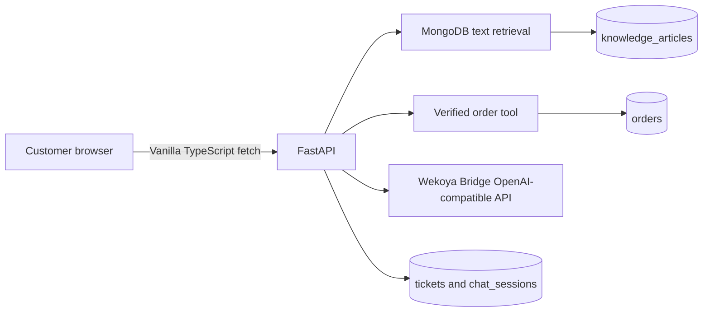

# Support Copilot

Support Copilot is a polished portfolio MVP for a fictional Lagos electronics retailer, **Kora Electronics**. It combines curated MongoDB support articles, verified demo order records, and Wekoya Bridge AI into a compact customer-support experience.

## Features

- Curated knowledge-base retrieval with MongoDB text search
- Retrieved-article citations with an in-page reference panel
- Verified order-status tool calls scoped to the selected demo customer
- Safe refusal and human escalation when information is insufficient
- Mock human-support ticket creation
- Responsive, keyboard-accessible vanilla TypeScript interface
- Limited retries for transient Wekoya/Bridge failures
- Session persistence in MongoDB and localStorage



## Prerequisites

- Python 3.12
- [uv](https://docs.astral.sh/uv/)
- Node.js 20+ and npm
- Docker with Docker Compose

## Wekoya setup

1. Create a Bridge account.
2. Top up the Wekoya wallet.
3. Create a Bridge API key.
4. Copy `.env.example` to `backend/.env` and put the key in `WEKOYA_API_KEY`.
5. Keep `WEKOYA_MODEL=gemini-2.5-flash-lite`.

The API key is used only by the FastAPI server. Never add it to frontend files or expose it through API responses.

## Start locally

Start MongoDB:

```bash
docker compose up -d mongodb
```

Create the Python environment and seed demo data:

```bash
cd backend
uv sync --extra test
cp ../.env.example ../backend/.env
uv run python -m app.seed
```

Start FastAPI:

```bash
cd backend
uv run uvicorn app.main:app --reload --host 0.0.0.0 --port 8000
```

Start Vite in another terminal:

```bash
cd frontend
npm install
npm run dev
```

Open `http://localhost:5173`.

## Tests

```bash
cd backend
uv run pytest
```

Production frontend build:

```bash
cd frontend
npm run build
```

## Example requests

Health:

```bash
curl http://localhost:8000/api/health
```

Chat:

```bash
curl -X POST http://localhost:8000/api/chat \
  -H 'Content-Type: application/json' \
  -d '{"customer_id":"cust-ada","message":"What is your return policy?"}'
```

Order status:

```bash
curl -X POST http://localhost:8000/api/chat \
  -H 'Content-Type: application/json' \
  -d '{"customer_id":"cust-ada","message":"Where is order KORA-1001?"}'
```

Create a ticket:

```bash
curl -X POST http://localhost:8000/api/tickets \
  -H 'Content-Type: application/json' \
  -d '{"customer_id":"cust-ada","subject":"Damaged item","description":"My item arrived damaged."}'
```

## Screenshot

**Screenshot/GIF placeholder:** add a demo screenshot or recording here.

## Limitations and planned upgrades

- Replace MongoDB text search with MongoDB Atlas Vector Search
- Add embeddings for semantic retrieval
- Add streaming responses with SSE
- Add authentication and real customer identity
- Integrate a real ticketing provider
- Add per-user Wekoya budgets
